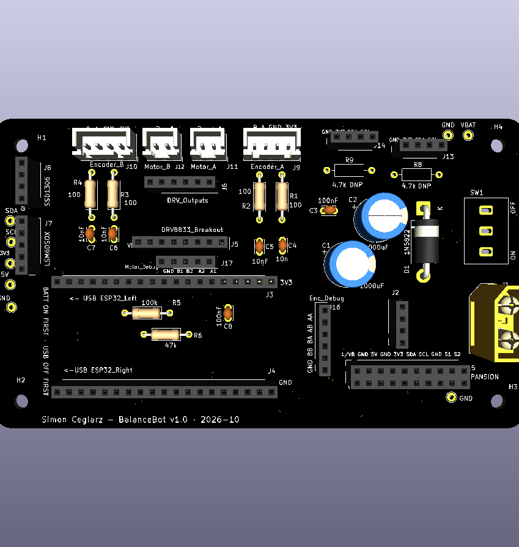
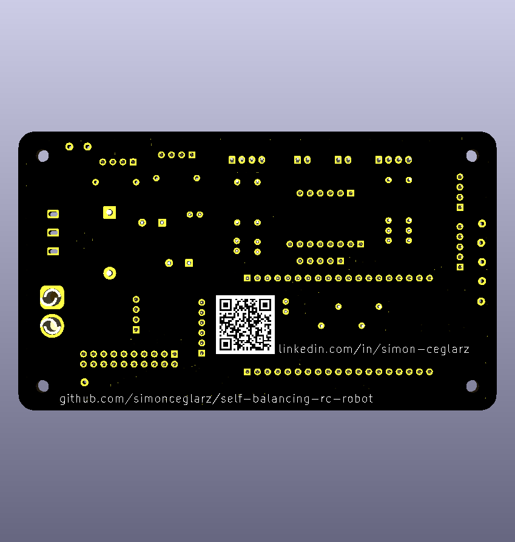
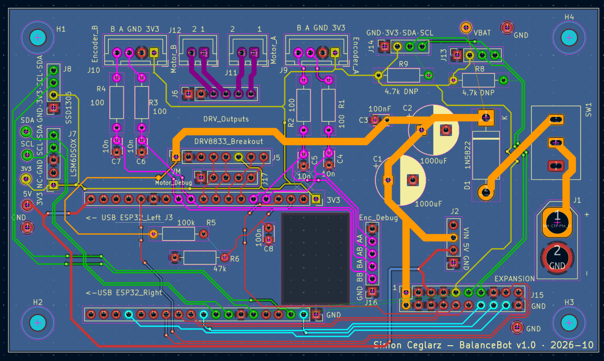

# Custom PCB: Rev 1

A 2-layer KiCad PCB that replaces the robot's hand-wired perfboard. It carries the ESP32 DevKit, the DRV8833 motor driver and the 5 V buck on sockets, and adds a dedicated motor-control and sensor layout plus an expansion header for v2 features.

**Status (Oct 2026):** layout complete, DRC clean, ordered from JLCPCB. Bring-up and testing on the robot are next. This page will be updated with measurements.

| Front | Back |
|---|---|
|  |  |

---

## Board summary

| Item | Value |
|---|---|
| Size | 120 × 70 mm, rounded corners, 4 × M3 mounting holes |
| Stack-up | 2 layers, 1.6 mm FR4, 1 oz copper |
| Assembly | All through-hole, hand-soldered |
| Modules (socketed) | ESP32-WROOM DevKit (38-pin), Adafruit DRV8833, Adafruit MPM3610 5 V buck |
| Power input | 2S LiPo (7.4 V) via XT60 → toggle switch → 1N5822 Schottky (reverse polarity) → 2 × 1000 µF + 100 nF |
| Connectors | JST-XH for motors and encoders; 0.1" headers for IMU, OLED and two I2C ports; 2 × 10 expansion socket |
| Ground | Poured on both layers, stitched with vias |
| DRC | 0 errors, 0 unconnected items |
| Tools | KiCad 9, JLCPCB |

---

## Design decisions

### 1. Modules on sockets instead of bare chips
The ESP32, motor driver and buck all plug in as breakout boards. A bare ESP32 module would have needed USB, auto-reset and boot circuitry, and the DRV8833 IC comes in an HTSSOP package with a thermal pad that isn't practical to hand-solder. Socketing also means a damaged module can be swapped without desoldering, which matters on a robot that falls over during tuning.

### 2. Traces sized by current
Trace widths come from net classes, sized with IPC-2221 for 1 oz outer copper and a ~10 °C rise:

| Net class | Nets | Width | Expected current |
|---|---|---|---|
| Battery | Battery input, switch, diode, VBAT rail | 1.5 mm | ~2–3 A continuous (both motors + logic, headroom for servos) |
| Motor | DRV8833 outputs | 1.0 mm | up to ~1.2 A continuous / 2 A peak per channel |
| 5V | Buck output | 0.5 mm | up to 1.2 A (MPM3610 limit) |
| Default | Signals, 3.3 V | 0.25 mm | well under 0.5 A |

### 3. Two I2C buses
On the perfboard the IMU and OLED shared one bus. A full SSD1306 refresh is ~1 KB, roughly 23 ms at 400 kHz, which is longer than two 10 ms control-loop periods. The PCB gives the IMU its own bus (GPIO 19/18) and moves the OLED and all future I2C devices to a second bus (GPIO 21/22), so a display update can never delay an IMU read.

### 4. GPIO remapping for clean routing
The perfboard pin assignments forced the motor-control and encoder traces to cross the board. Because the ESP32's PWM and input pins are interchangeable for these signals, I reassigned 8 GPIOs so each group runs straight from its connector to the ESP32 with no crossings:

| Signal | Perfboard GPIO | PCB GPIO |
|---|---|---|
| Motor A IN1 / IN2 | 26 / 32 | 32 / 33 |
| Motor B IN1 / IN2 | 25 / 33 | 26 / 25 |
| Encoder A ch. A / B | 27 / 14 | 34 / 35 |
| Encoder B ch. A / B | 34 / 35 | 27 / 14 |
| OLED SDA / SCL | 19 / 18 (shared) | 21 / 22 (own bus) |

The firmware selects the mapping with a single `#define PCB_REV1` switch, so the same code runs on both the perfboard and the PCB.

### 5. Expansion header for v2
A 2 × 10 female socket (J15) exposes everything a future daughterboard needs: battery, 5 V, 3.3 V, the second I2C bus, UART2, I2S (for a speaker amp), two servo PWM pins and one ADC1 input.
- **Safe pins only.** ESP32 strapping pins (GPIO 0, 2, 12) are left off, so a daughterboard can never stop the robot from booting. GPIO 5 and 15 are only used for I2S, where a glitch at boot is harmless.
- **ADC1 only.** The analog input is GPIO39, because ADC2 doesn't work while WiFi is on.
- **Power pins fenced by ground.** A solder bridge between neighbouring pins can't short 8.4 V onto 3.3 V.
- **Female socket**, so battery voltage is never on exposed pins.
- Servos and audio are meant to get their own regulator on the daughterboard, fed from the battery pins, since the MPM3610 is limited to 1.2 A.

### 6. Signal integrity on a 2-layer board
- **Solid bottom ground plane.** Almost all routing is on the top layer; the bottom layer is a ground pour, used only for short perpendicular hops.
- **Top ground pour stitched with vias** around the edges, beside bottom-layer hops, and inside dense trace bundles, so isolated copper islands stay grounded.
- **Ordering in the expansion bus.** The I2S clock (BCLK, ~2.8 MHz) runs in the middle of its own group, UART acts as a buffer between I2S and I2C, and servo lines run next to the 5 V rail. I2C is kept furthest from BCLK because it's open-drain, so a coupled spike on SCL can look like an extra clock edge.
- **Fixing a ground-plane gap.** Three adjacent bottom-layer hops left a ~4 × 2.5 mm hole in the ground pour directly under BCLK's path. Moving the hop to BCLK instead (one via instead of six) closed the gap.
- **Antenna keep-out.** A rule area keeps tracks, vias and copper pours out from under the ESP32's PCB antenna on both layers.
- **High-impedance nodes.** The battery-sense divider node (~32 kΩ) is crossed at right angles only, and filtered with 100 nF (τ ≈ 3.2 ms).

### 7. Debug access
The DevKit and DRV8833 cover their own pins once plugged in, so signals under them get dedicated access:
- **Motor_Debug (J17):** all four motor PWM lines plus ground, in line between the driver and the ESP32.
- **Enc_Debug (J16):** all four filtered encoder channels with ground on both ends.
- **Test points** for VBAT, 5 V, 3.3 V, IMU SDA/SCL and ground.
- **Optional I2C pull-ups** (R8/R9, not fitted by default) for when the connected modules don't provide their own.

---

## Mistakes caught before ordering

| Problem | How it was found | Fix |
|---|---|---|
| DRC reported 499 violations, hitting KiCad's per-type cap and hiding real errors | Every flagged item was silkscreen on the same footprint | An unconditioned custom "physical clearance" rule was checking every footprint's graphics against itself. Deleted it |
| DevKit header rows placed 23.5 mm apart | 23.5 mm isn't a multiple of 0.1"; counted the holes on the perfboard | Caliper error measuring edge-to-edge. Real spacing is 0.9" (22.86 mm) |
| DRV8833 rows placed 13.35 mm apart | Same off-grid check | Took 12.70 mm (0.5") from Adafruit's fabrication drawing |
| XT60 footprint was the same gender as the battery's plug | Pre-order check against the real battery lead | Swapped to the male footprint |
| Power switch had no matching library footprint | Compared the real switch against library parts | Drew a custom footprint to match it |

All module footprints were checked against the real parts before ordering.

---

## Pinouts

**ESP32 DevKit (PCB rev 1)**

| Function | GPIO | Function | GPIO |
|---|---|---|---|
| IMU SDA / SCL (bus A) | 19 / 18 | Motor A IN1 / IN2 | 32 / 33 |
| OLED + ports SDA / SCL (bus B) | 21 / 22 | Motor B IN1 / IN2 | 26 / 25 |
| Encoder A ch. A / B | 34 / 35 | Battery sense (ADC1) | 36 |
| Encoder B ch. A / B | 27 / 14 | Expansion analog in (ADC1) | 39 |

**Expansion header J15** (top row odd, pin 1 = square pad)

| Pin | Net | Pin | Net |
|---|---|---|---|
| 1 | VBAT | 2 | VBAT |
| 3 | GND | 4 | GND |
| 5 | 5V | 6 | GND |
| 7 | GND | 8 | EXP_IN (GPIO39, ADC1, input only) |
| 9 | 3V3 | 10 | UART2 TX (GPIO17) |
| 11 | I2C B SDA (GPIO21) | 12 | UART2 RX (GPIO16) |
| 13 | I2C B SCL (GPIO22) | 14 | I2S LRC (GPIO5) |
| 15 | GND | 16 | I2S BCLK (GPIO23) |
| 17 | Servo 1 (GPIO4) | 18 | I2S DIN (GPIO15) |
| 19 | Servo 2 (GPIO13) | 20 | GND |

**I2C ports J13 / J14:** GND · 3V3 · SDA · SCL (Qwiic pin order on 0.1" headers).

---

## Bring-up plan

1. Visual and DMM check: no shorts from VBAT, 5 V or 3.3 V to ground, and no battery voltage on any module socket pin.
2. Power on with all modules removed and measure every socket pin.
3. Add the buck → check 5 V. Add the DevKit → check 3.3 V. Add the DRV8833 last.
4. Measure the bus B pull-up resistance; fit R8/R9 only if it's open or very high.
5. Run the motor/encoder test with `PCB_REV1 1` to confirm each motor and its encoder.
6. Scope captures: motor PWM, raw vs filtered encoder edges, I2C traffic, and rail dips during motor steps.

---

## Files

| Path | Contents |
|---|---|
| `kicad/` | KiCad 9 project: schematic, layout, custom footprints |
| `gerbers/` | Fabrication files sent to JLCPCB |
| `docs/schematic.pdf` | Schematic export |

---

## Next

- Bring-up results and measurements (rail ripple, encoder edges, motor current).
- Compare WiFi range against the perfboard build, since the board now sits under the antenna.
- Measure motor stall current to confirm whether the DRV8833 (1.2 A per channel) has enough headroom for self-righting, or whether rev 2 needs a stronger driver.
- A possible rev 2 replacing the modules with a bare ESP32 module, the DRV8833 IC and an SMD buck, assembled by the fab.
